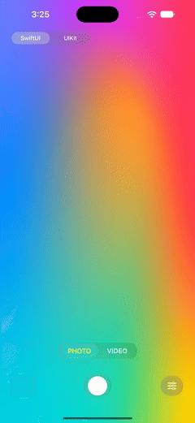

# CameraButton

[](https://github.com/Ramiz69/CameraButton/actions)
[](https://swift.org/package-manager/)
[](https://github.com/Ramiz69/CameraButton/blob/master/LICENSE)
[](https://developer.apple.com/ios/)
[](https://swift.org)

- [Installation](#installation)
- [Author](#author)
- [License](#license)

## Requirements

- iOS 15.0+
- Xcode 26.0+ (Liquid Glass style requires iOS 26; earlier systems fall back to the classic style)
- Swift 6.0+

## Preview


## Installation

### Swift Package Manager

The [Swift Package Manager](https://swift.org/package-manager/) is a tool for automating the distribution of Swift code and is integrated into the `swift` compiler.

Once you have your Swift package set up, adding CameraButton as a dependency is as easy as adding it to the `dependencies` value of your `Package.swift` or the Package list in Xcode.

```swift
dependencies: [
    .package(url: "https://github.com/Ramiz69/CameraButton.git", .upToNextMajor(from: "1.0.0"))
]
```

Normally you'll want to depend on the `CameraButton` target:

```swift
.product(name: "CameraButton", package: "CameraButton")
```

### CocoaPods

CocoaPods is no longer supported starting with 1.0.0. The last published pod is `RKCameraButton 0.0.4`. Please migrate to Swift Package Manager.

### Manually
Copy the contents of the `Sources` folder into your project.

### Usage

#### UIKit

```swift
let button = CameraButton()
button.type = .video          // .photo or .video
button.style = .glass         // Liquid Glass on iOS 26+, classic ring otherwise
button.delegate = self
view.addSubview(button)       // 60×60 intrinsic size, or constrain it
```

In storyboards, add a button and set its class to `CameraButton` in the Identity Inspector.

#### SwiftUI

```swift
@State private var isRecording = false

CameraShutterButton(type: .video, style: .glass, isRecording: $isRecording) {
    isRecording ? recorder.start() : recorder.stop()
}
.frame(width: 72, height: 72)
```

`CameraShutterButton` is a thin wrapper over the same `CameraButton`, so both share one implementation.

#### Recording progress

```swift
button.animateRecordingProgress(duration: 15) // fills the ring over the max clip length
button.recordingProgress = 0.4               // or drive it manually
```

The ring resets when recording stops.

#### Customization

| Property | Description |
| --- | --- |
| `style` | `.classic` or `.glass` |
| `glassTintColor` | Tint of the glass disc |
| `photoColor`, `videoColor` | Fill of the inner shape |
| `ringColor`, `ringLineWidth`, `ringOffset` | Classic ring appearance |
| `progressColor` | Recording ring color |
| `isHapticFeedbackEnabled` | Haptics on capture and record toggle |

The button supports VoiceOver labels, Dynamic colors and Reduce Motion out of the box.

## Example app

Open `CameraButton.xcodeproj` and run the `CameraButton-Example` scheme (iOS 18+). It is a SwiftUI camera screen with:

- a live camera preview on device and an animated scene in the Simulator;
- photo and video modes with a recording timer and a 15 s limit;
- a Playground sheet that edits every button property live and shows the matching Swift code;
- a SwiftUI / UIKit switch that renders the same button through `CameraShutterButton` or through `CameraButton` with a delegate.

## Author

ramiz69, ramiz161@icloud.com

## License

CameraButton is available under the MIT license. [See LICENSE](https://github.com/Ramiz69/CameraButton/blob/master/LICENSE) for details.
